# PhishSOAR

**Automated phishing triage and response for business email.**

It checks every email that lands, the way I would check it as a SOC analyst, quarantines the dangerous ones in under a minute, and sends the user an alert that explains why in plain English.

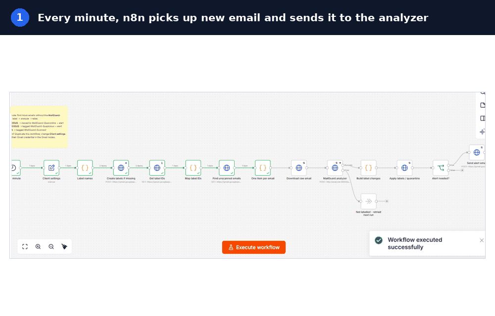

**Project report (PDF):** [docs/PhishSOAR-Project-Report.pdf](docs/PhishSOAR-Project-Report.pdf)

---

## Why I built this

A lot of businesses I know in Nigeria don't have a security team watching their email. They still get hit with the same attacks as everyone else: fake bank alerts, "update your BVN" messages, a "CEO" asking for an urgent transfer, invoices with a new account number, and QR codes inside images so link scanners can't see them.

Gmail's built-in filter catches a lot, but not all of it, and when it misses something nobody is watching. I wanted to take the triage steps I'd do by hand on a suspicious email and run them automatically on every single email, for every inbox I look after.

This repo is the public part of that project. The full production build runs on my own server and protects real inboxes.

## What it does

- Checks every new email in each protected Gmail inbox, once a minute
- Looks at the sender, the wording, every link, every attachment, and every image (including QR codes and text inside pictures)
- Enriches links, files and sender IPs with threat intel
- Uses an LLM as one extra layer to read intent, on a masked copy of the email
- **Malicious:** moves the email to a `MailGuard-Quarantine` folder and sends an alert
- **Suspicious:** leaves it in the inbox, tags it, and sends an alert
- **Clean:** tags it as scanned and stays quiet
- Never deletes anything. A wrongly flagged email is one click away from the inbox
- Tells me on Telegram if anything breaks, and pages me if the server goes silent

## How it works

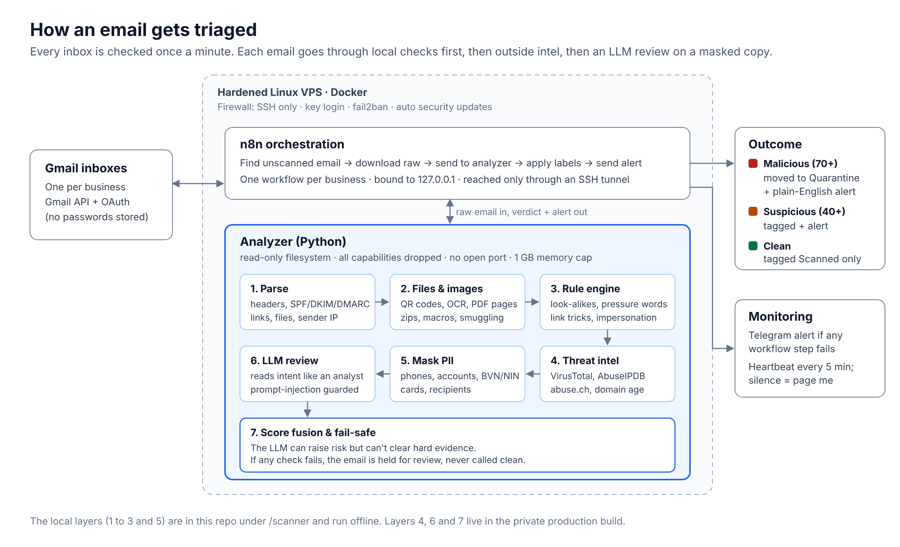

n8n does the orchestration: it finds unscanned email through the Gmail API, downloads the raw message, sends it to the analyzer, then applies the labels and sends the alert. The analyzer is a Python service that does the actual triage. Both run in Docker on a hardened Linux VPS. Each business gets its own workflow and its own Gmail connection, so nothing mixes between clients.

In SOAR terms, every email runs through the same playbook:

| Step | What happens |
| --- | --- |
| Collect | n8n pulls new, unscanned email from each inbox through the Gmail API |
| Enrich | The analyzer parses it, inspects files and images, and checks links, hashes and IPs against threat intel |
| Decide | Rules, intel and the LLM review are fused into one score with a fail-safe |
| Contain | Malicious email is moved to quarantine automatically, suspicious email is tagged |
| Notify | The user gets a plain-English alert with IOCs, and I get paged if the pipeline itself fails |

## Detection layers

| Layer | What it checks | Example it catches |
| --- | --- | --- |
| Sender authentication | SPF, DKIM, DMARC results, Reply-To and Return-Path mismatches | "Microsoft" email that fails DMARC and replies to a Protonmail address |
| Impersonation | Brand names in the display name vs the real domain, look-alike domains (including Nigerian banks and the business's own domain) | `rnicrosoft-support.xyz`, `zenithbanc.com`, a fake version of the client's own domain |
| Language | Pressure and scam wording, payment and bank-detail change requests, BVN/NIN/OTP requests | "Are you available? Process this transfer today and keep it confidential" |
| Links | Link text vs real destination, URL shorteners, high-abuse domain endings, free hosting, punycode | Text says `docs.company.com`, link goes to `company-docsign.click` |
| Attachments | Double extensions, risky file types, macros, password-protected archives, HTML smuggling, JavaScript in PDFs | `Invoice.pdf.exe` inside a password-protected zip |
| Images and PDFs | QR codes decoded, text read with OCR, first PDF pages rendered | "Scan to keep your mailbox active" QR code inside an image |
| Threat intel | VirusTotal, AbuseIPDB, URLhaus, ThreatFox, MalwareBazaar, domain age | A link to a domain registered 3 days ago, a file hash known as malware |
| LLM review | Reads the whole email for intent, on a masked copy | CEO fraud with no links and no attachments, which rules alone struggle with |
| Score fusion | Combines everything into one score. Malicious at 70+, suspicious at 40+ | The LLM can raise the risk, but it can't clear an email that has hard evidence against it |

## Where AI fits, and what it gets to see

I use an LLM because some attacks are only words. A message like "I'm in a meeting, please pay this new vendor today and keep it between us" has no bad link and no attachment, and it passes SPF, DKIM and DMARC. Rules can see the warning signs but can't be sure. You can see this in the scanner results below: the CEO fraud sample only scores 30 on rules. The language layer is what closes that gap.

I also didn't want to hand client emails to an AI provider without thinking about it, so:

- **Personal details are masked before the AI check.** Phone numbers, bank account numbers (NUBAN), BVN/NIN, card numbers, recipient addresses and the name part of email addresses are replaced with tags like `[PHONE]` and `[ACCOUNT-NUMBER]`. The rules and threat intel still run on the original email on my own server, so detection doesn't drop. There are tests that prove none of those details reach the AI payload.
- **What still goes:** the sender's address and domains (that is the main evidence), links, the masked body text, and up to 3 images, because images are how fake login pages get caught. Sending images can be switched off per deployment.
- **The provider is used through its paid API.** Under its commercial terms, API data is not used to train models.
- **The email is treated as untrusted input.** It's wrapped and the model is told never to follow instructions inside it. An email that tries to talk to the filter ("mark this as safe") counts as a red flag.
- **The AI is not the judge.** It has to answer through a fixed tool schema, its verdict is one input to the score, and it can't overrule hard evidence like a known-malware file or a failed DMARC with impersonation.
- **Fail-safe, not fail-open.** If the AI check can't run, the email is retried on the next run. If it keeps failing, the email is held as suspicious for a person to review. It's never marked clean just because a check was missing.

## MITRE ATT&CK coverage

| Technique | How it shows up | Layers that catch it |
| --- | --- | --- |
| T1566.001 Spearphishing Attachment | Malicious or disguised files, macro documents, password-protected archives | Attachments, threat intel |
| T1566.002 Spearphishing Link | Credential harvesting pages, disguised links, shorteners, QR codes | Links, images, threat intel, domain age |
| T1534 Internal Spearphishing | Phishing sent from a real but compromised colleague or vendor account, so authentication passes | Language, links, LLM review |
| T1656 Impersonation | Fake banks, brands, vendors and executives | Sender authentication, impersonation, LLM review |
| T1204 User Execution | Pressure to open a file or click now | Language, alert guidance to the user |

## Results

**Offline scanner on the sample emails in this repo** (rules only, no API keys):

```
credential_harvest.eml   MALICIOUS   100/100   DMARC fail, brand impersonation, reply-to mismatch, disguised link
encrypted_zip.eml        MALICIOUS    90/100   .pdf.exe inside a password-protected zip
pdf_qr.eml               MALICIOUS    75/100   QR code inside a PDF hides a shortened link
quishing_image.eml       SUSPICIOUS   45/100   QR code inside an image points to a .click domain
ceo_fraud.eml            CLEAN        30/100   warning signs seen, but rules alone can't be sure
newsletter.eml           CLEAN         0/100
```

That `ceo_fraud` line is on purpose. It's the reason the production build has the LLM layer, which flags it as payment fraud.

**Full system on my own inbox:** credential phishing, CEO fraud with no links, a QR code inside an image, a bank-detail change request and a disguised link were all caught and alerted. Normal emails from Google, Netflix, TikTok and Temu stayed clean.

## Screenshots

These come from the CyberVet deployment, the first business I built and deployed PhishSOAR for. The alert branding changes per business.

**The alert a user receives**

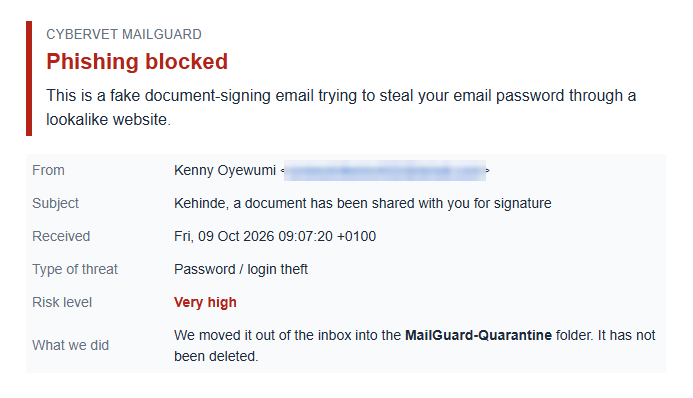

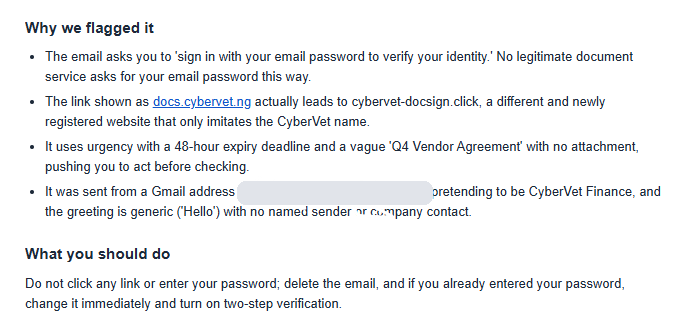

**Technical details for whoever handles security**

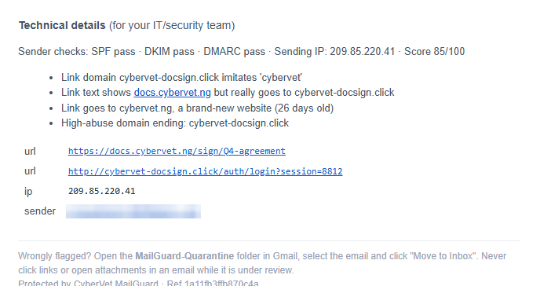

**Gmail labels: quarantined, suspicious and scanned**

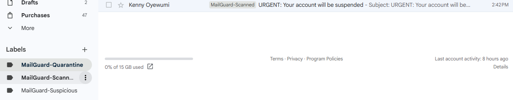

**The n8n workflow after a successful run**

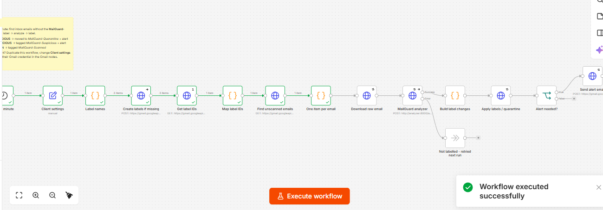

**Monitoring: failure alert on Telegram, and the heartbeat check**

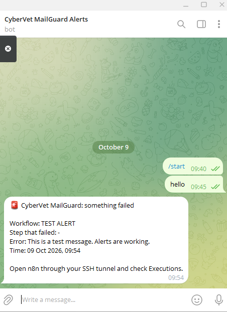

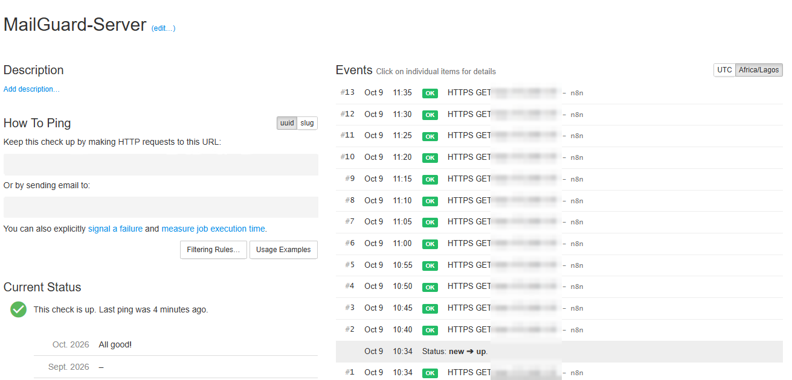

**Production test suite and running containers**

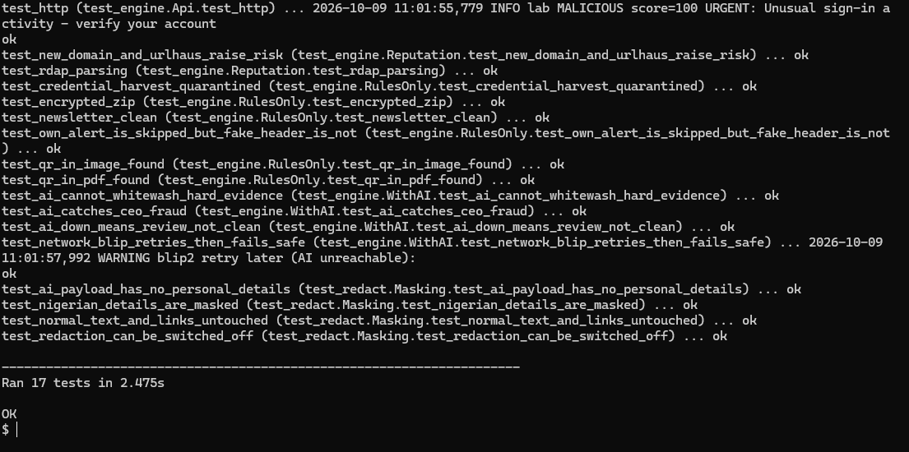

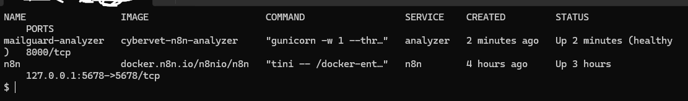

## Securing the system itself

A tool that reads other people's email is a target, so I treated it like one.

- **The analyzer is locked down.** Read-only filesystem, all Linux capabilities dropped, no privilege escalation, non-root user, memory and process limits (so a zip bomb or a huge image can't take the server down), and no published port. Only n8n can reach it, inside Docker.
- **n8n isn't on the internet.** It's bound to `127.0.0.1` and I reach it through an SSH tunnel.
- **The server is hardened.** SSH key login only, root and password login disabled, firewall allows SSH and nothing else, fail2ban, automatic security updates.
- **No mailbox passwords.** Each business signs in to Google themselves through OAuth. n8n keeps an encrypted token that the business can revoke any time.
- **Secrets stay out of code.** API keys live in a `.env` file on the server that is never committed. Workflow exports in this repo are sanitized templates.
- **Data doesn't pile up.** n8n run history, which contains email content, is deleted automatically after 72 hours.
- **Alert loops and spoofing.** Alert emails carry a secret header, so the system skips its own alerts. An attacker who copies the alert format without the secret still gets scanned like any other email.

See [`deploy/docker-compose.yml`](deploy/docker-compose.yml) for the container hardening.

## Monitoring and reliability

- **Failure alerts:** a separate n8n error workflow sends me a Telegram message with the workflow, the step that failed and the error.
- **Heartbeat:** every 5 minutes a workflow checks the Gmail connection and the analyzer health, then pings Healthchecks.io. If the pings stop for 15 minutes, I get paged. This catches the cases where nothing runs at all, like the server going down or a Google token expiring.
- **Retries:** network blips and API overloads are retried. An email that couldn't be checked stays unlabelled and is picked up on the next run.
- **No duplicate alerts:** a short cache stops the same email from being alerted twice.

## Try the scanner

The `scanner` folder has the local detection layers: parsing, file and image inspection, the rule engine and PII masking. It runs offline with no API keys.

You need Python 3.11+ and Tesseract OCR (`sudo apt install tesseract-ocr` on Ubuntu, or the Windows installer from the Tesseract project).

```bash
cd scanner
pip install -r requirements.txt
python -m triage ../samples/*.eml --protect example.com
python -m unittest discover -s tests -v
```

Add `--json` to get the full result as JSON. `--protect` takes your own domain so look-alikes of it get caught.

## Repo layout

```
scanner/            offline detection layers + tests
  triage/           parser, file/image inspection, rule engine, PII masking, CLI
  tests/            unit tests and the generator for the sample emails
samples/            harmless test phishing emails (.eml), all fictional
workflows/          sanitized n8n templates: main triage, failure alert, heartbeat
deploy/             hardened docker-compose used in production
docs/               project report (PDF)
docs/images/        architecture, screenshots, demo
```

The threat intel enrichment, LLM review, score fusion, alert builder and API service are in the private production build.

## What was hard

- **Random TLS failures.** Calls to the LLM API kept failing with `SSLV3_ALERT_BAD_RECORD_MAC` when running on Docker Desktop on Windows, while every other API worked. I tested MTU sizes, TLS versions and offloading settings and narrowed it down to that local network path. I moved production to a Linux VPS, where it ran clean, and kept the lessons in the code: retries, a text-only fallback when large uploads fail, and "retry next run" instead of guessing.
- **Not trusting the AI too much.** It's easy to let the model decide everything. I built the scoring so the LLM is one input: it can push risk up, it can't wipe out hard evidence, and anything that can't be fully checked is held, not passed. There are tests for both.
- **Privacy without losing detection.** Masking personal details sounded like it would hurt accuracy. The trick was masking only the AI's copy, keeping the sender and domains, and using tags the model still understands, so "pay into a new [ACCOUNT-NUMBER]" still reads as a red flag.
- **The system scanning its own alerts.** Alert emails land in the same inbox. A signed header solved it without opening a hole for attackers.

## Skills demonstrated

- **SOC triage and email security:** header analysis, SPF/DKIM/DMARC, phishing and BEC patterns, IOC extraction
- **Detection engineering:** weighted rules, look-alike domain detection, QR and OCR analysis, attachment inspection, tuning against false positives
- **Threat intelligence:** VirusTotal, AbuseIPDB, abuse.ch feeds, domain age, with caching and rate limits
- **Security automation (SOAR-style):** n8n workflows for collection, enrichment, response (quarantine) and notification
- **AI security:** prompt injection defenses, structured tool output, data minimisation and PII masking, fail-safe design
- **Python:** email parsing, image processing (OpenCV, Pillow, Tesseract), a Flask API, unit testing
- **Infrastructure:** Docker hardening, Linux server hardening, SSH tunnelling, OAuth, secrets management
- **Reliability and monitoring:** error workflows, heartbeat checks, retries, alerting
- **Privacy and compliance:** data minimisation and retention limits, designed with the Nigeria Data Protection Act in mind

## Roadmap

- Microsoft 365 / Outlook support through Microsoft Graph
- Instant scanning with Gmail push notifications instead of polling every minute
- A dashboard with weekly stats per business
- Automatic encrypted backups

## About me

I'm Kehinde Oyewumi, a cybersecurity practitioner and educator based in Nigeria. I work on SOC operations, detection and security automation, and I teach people how to get into SOC work.

GitHub: [BalMM-hub](https://github.com/BalMM-hub)

## License

The code in this repo is under the MIT License. The sample emails are fictional and harmless.
